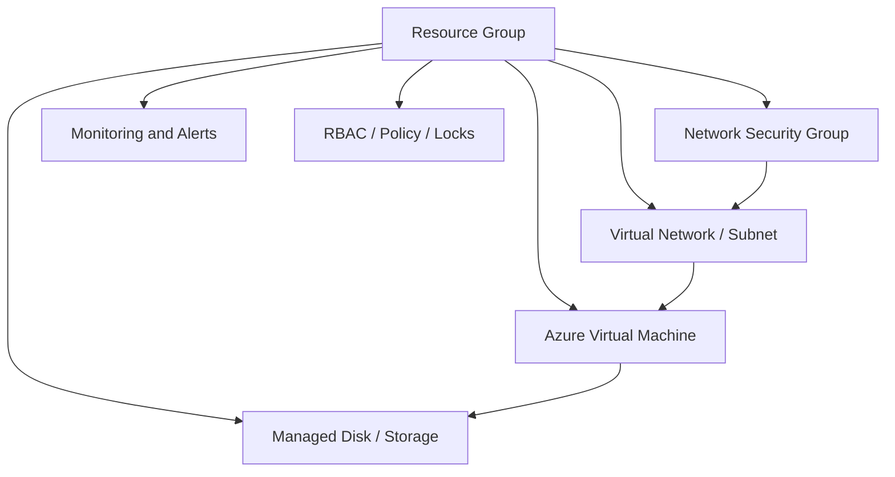

# Azure Infrastructure Administration Lab

**[View the published screenshot evidence gallery](docs/published-evidence-gallery.md)** — 9 screenshots with evidence limitations.

Hands-on Azure infrastructure exercises covering compute, virtual networking, storage, access control, governance, monitoring, and resource cleanup. These are historical test-environment exercises, not a continuously deployed production architecture.

## What I actually tested

I used Azure Portal and Azure CLI to inspect a test virtual machine, virtual networking, resource inventory, role assignments, managed disks, and resource-group governance. A resource-lock exercise and cleanup checks are documented. Some captured states were stopped, pending, or unsuccessful; the screenshots are presented as observations rather than proof of a production-ready deployment.

## Resource relationships

## Recorded exercises

- Created resource groups, virtual networks/subnets, NSGs, a VM, and storage/disk resources.
- Reviewed role-based access control and Azure Policy settings.
- Reviewed monitoring and budget controls; specific successful alert/budget configuration needs screenshot or command verification.
- Tested a resource lock and observed a `ScopeLocked` error.
- Used Azure CLI to export an inventory of nine resources.
- Historical notes describe resource-group teardown and remaining-resource checks; independent verification of complete cleanup is not included in the published evidence.

## Evidence and limitations

See the [evidence matrix](docs/evidence-matrix.md) for the screenshots examined and what they demonstrate.

A September 9 screenshot shows the lab VM in **Stopped (deallocated)** state, supporting resource existence but not a running service. September 10 inventory screenshots do not independently verify connectivity, security posture, or every provisioning state.

**No raw Azure portal screenshots are published.** Ten sanitized candidates are being prepared for private review. Subscription IDs, tenant IDs, public IPs, and other identifiers require redaction.

## Further validation

- Publish sanitized deployment screenshots and resource inventory output.
- Recover network connectivity/NSG validation results, if preserved.
- Add resource-lock and cleanup verification evidence.
- Publish exact commands or scripts only when recovered or independently tested.

## Azure technical walkthroughs

- [Azure compute, networking, and storage](docs/deployment-and-networking.md)
- [Governance, monitoring, locks, and cleanup](docs/governance-and-cleanup.md)

