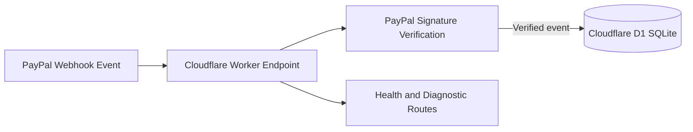

# Separate Project — Cloudflare Worker and PayPal Webhooks

> **Not part of the Azure infrastructure lab.** This is an unrelated serverless integration project preserved here for reference. Its presence does not demonstrate Azure deployment or Azure-specific skills.

This is a separate independent project demonstrating cloud service integration, API authentication troubleshooting, and serverless persistence. **Cloudflare Workers are not Azure services**; this case study is included to show transferable cloud engineering skills.

## System design

## Implemented components

- Cloudflare Worker endpoints including `/health`, `/webhooks/paypal`, and `/db-test`.
- Cloudflare D1 tables for payments and webhook event tracking.
- PayPal OAuth token flow and webhook signature verification integration.
- Tests of missing signature headers, invalid signatures, authentication failures, and service-unavailable responses.
- Database connectivity check and deployment/log inspection.

## Troubleshooting progression

| Observation | Interpretation |
| --- | --- |
| Initial request returned HTTP 500 | Verification failure required further diagnosis |
| Request without required headers returned 401 | Missing signature header validation |
| Verification unavailable returned 503 | Verification dependency unavailable |
| Invalid signature returned 401 | Invalid requests were rejected |
| OAuth request returned 401 in logs | Authentication configuration required correction |

**Important boundary:** These tests demonstrate endpoint behavior and troubleshooting, not proof that a complete live paid transaction was successfully verified, persisted, and reconciled end-to-end. That outcome requires separate evidence.

## Engineering lessons

- Keep credentials in secret/environment bindings rather than source code.
- Verify webhook authenticity before trusting or storing payment event claims.
- Make webhook processing idempotent and record event IDs safely.
- Separate availability checks from security verification.
- Use structured logging without exposing payment details or tokens.

Do not publish client IDs, secrets, webhook identifiers, transaction identifiers, or payment account details.
