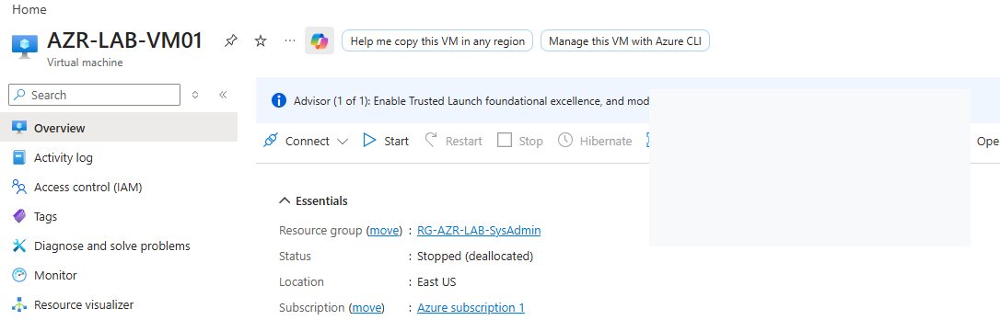
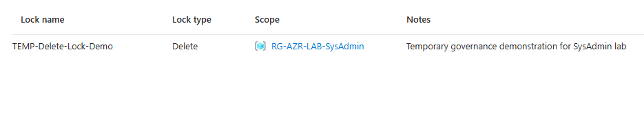
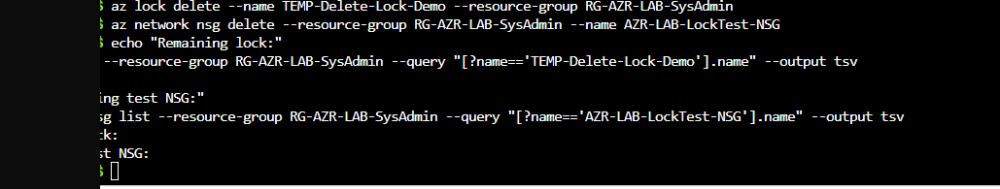
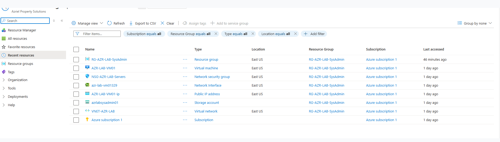
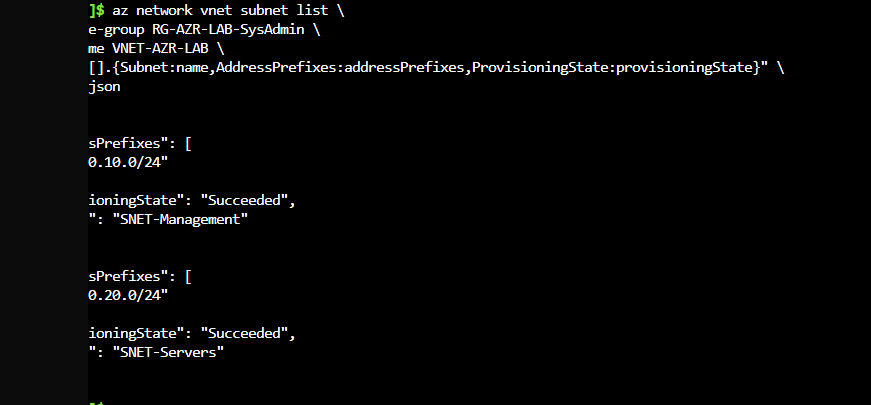
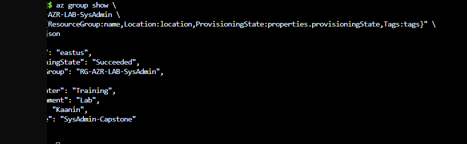
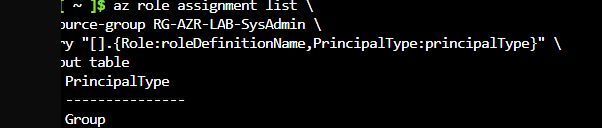
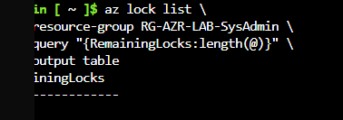
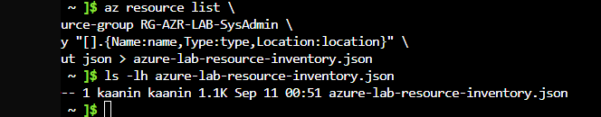

# Azure Infrastructure Lab — Published Screenshot Gallery

These images were uploaded by the lab owner. Captions describe the observed evidence without implying production readiness or completed validation that the images do not establish. **Publication does not mean a new independent full-resolution privacy audit has been completed.** If any image contains a sensitive identifier, remove it from GitHub and its history as appropriate.

## 1. Azure virtual machine

VM resource overview; deallocated state is not running compute.

## 2. Resource lock

Resource lock configuration at capture time.

## 3. Azure CLI resource-lock operation

Command/output; interpret success from visible result.

## 4. Azure resource inventory

Resource existence; not service reachability.

## 5. Virtual network and subnet inventory

Network objects, not proven connectivity.

## 6. Resource group properties

Resource-group metadata.

## 7. Role-based access assignments

Azure CLI role-assignment query and column headers are visible, but the cropped output does not show a complete role assignment; no effective access test is proven.

## 8. Resource-lock removal check

Observed lock status at queried scope.

## 9. Azure CLI resource export

Azure CLI resource-list command writes JSON and a file listing is visible; the screenshot does not independently verify the number of exported resources, cost, or complete cleanup.

## Evidence boundaries

Screenshots of configurations, inventories, report-only evaluations, pending states, or command attempts must not be described as end-to-end successful deployments. Original unredacted archives are not intended for public release.
